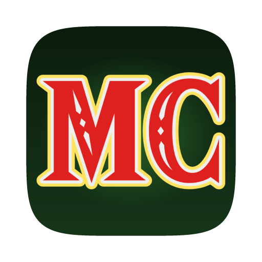

  

  

  Play <b>The Legend of Zelda: The Minish Cap</b> natively on macOS, Windows and Linux.

  
  
  

> [!IMPORTANT]
> MinCap does not include the game. You need your own legally dumped ROM of
> **The Legend of Zelda: The Minish Cap (USA)**, which MinCap checks before playing.
> MinCap is an unofficial fan project. It is not affiliated with, endorsed or sponsored by
> Nintendo. Zelda, The Minish Cap and all related names are trademarks of their respective owners.

## Download

Get the latest version from the [Releases page](https://github.com/sweatyeggs69/MinCap/releases/latest).

## Features

- **Native on macOS, Windows and Linux**, with smooth, tear-free video and sound.
- **Themed launcher** with **Continue** to pick up where you left off.
- **One settings menu (F1)** for display (scaling, screen effects) and controls.
- **Widescreen** (16:10 or 16:9): the extra columns are rebuilt from the room in memory, so rooms fill the wider screen.
- **Controllers and remapping** for keyboard and gamepads.
- **Save states**: ten slots with thumbnails, quick save/load (Slot 1 by default) and optional auto-load.
- **Fast forward and rewind**: hold Tab to speed up (2x or 4x), hold ` to rewind the last 10 seconds. Both rebindable in F1 > Controls; rewind is off in RetroAchievements hardcore mode.
- **Cheats** (F1 > Cheats): infinite hearts, max rupees, infinite bombs and arrows. Off in RetroAchievements hardcore mode.
- **Import saves** from RetroArch, mGBA, VBA-M and others.
- **RetroAchievements**, optional.
- **Automatic updates** from this repository's releases, with your OK, without touching your saves.
- **Optional BIOS** with the original boot animation (not required).

## FAQ

**Which version of the game is supported?**
The Legend of Zelda: The Minish Cap, USA release (game code `BZME`, revision 0).

**Do I need a GBA BIOS?**
No. MinCap has a built-in replacement. If you own a BIOS dump, Settings > Game > BIOS shows the
original boot animation.

**Where are my saves?**
In your user folder, never inside the app: `~/Library/Application Support/MinCap/MinCap/`
(macOS), `%APPDATA%\MinCap\MinCap\` (Windows) or `~/.local/share/MinCap/MinCap/`
(Linux).

## Contributing

Bug reports and pull requests are welcome. Keep game content out of the repository: no ROMs, BIOS
files, saves, save states, extracted assets or screenshots of the game.

## License

[MIT](LICENSE). Bundled open-source components and fonts are listed in
[THIRD_PARTY_NOTICES.md](THIRD_PARTY_NOTICES.md).
